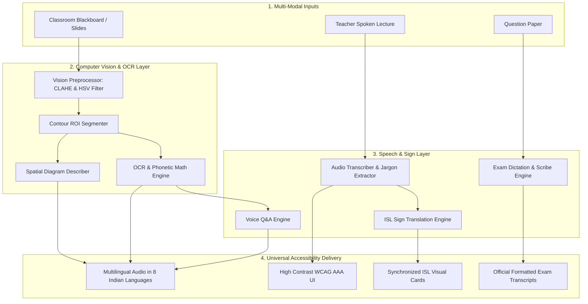

# NetraShiksha AI - System Architecture & Engineering Specifications

This document outlines the software engineering architecture, component interactions, API schemas, and deployment specifications for **NetraShiksha AI**.

---

## 1. Directory Structure

```
E:\netrashiksha-ai\
├── backend/
│   ├── main.py                     # FastAPI REST server & static mounting
│   └── engines/
│       ├── vision_preprocessor.py  # OpenCV CLAHE, board classification & ROI segmentation
│       ├── ocr_and_math_engine.py  # Multi-layer OCR, LaTeX & phonetic math reader
│       ├── diagram_describer.py    # Spatial audio guided tours of educational diagrams
│       ├── voice_qa_engine.py      # Conversational Q&A on blackboard contents
│       ├── audio_transcriber_engine.py # Subtitles, STEM jargon pills & flashcards
│       ├── isl_sign_engine.py      # Indian Sign Language dictionary & finger-spelling
│       ├── multilingual_tts.py     # 8 Indian languages speech synthesis & caching
│       ├── exam_dictation_engine.py # Verbal exam scribe & rubric evaluator
│       ├── generate_isl_assets.py  # Vector SVG generator for 62 ISL gesture cards
│       └── generate_sample_data.py # Sample board & diagram generator
├── data/
│   ├── audio_cache/                # Cached MP3 speech files
│   ├── sample_boards/              # Physics chalkboard, Math whiteboard JPGs
│   ├── sample_diagrams/            # Plant cell, Water molecule JPGs
│   └── sample_exams/               # CBSE Class XII question paper assets
├── docs/
│   ├── system_architecture.jpg     # System Architecture Infographic
│   ├── workflow_flowchart.jpg      # User Workflow Flowchart Infographic
│   ├── MASTER_PROJECT_REPORT.md    # Comprehensive academic report
│   ├── ARCHITECTURE.md             # Technical engineering specifications
│   ├── EXPLAIN_TO_FRIENDS.md       # Presentation and defense guide
│   └── VIVA_AND_INTERVIEW_QA.md    # 25 viva questions and answers
├── frontend/
│   ├── index.html                  # Accessible WCAG AAA UI interface
│   └── static/
│       ├── css/
│       │   └── styles.css          # High-contrast themes & responsive styling
│       ├── js/
│       │   └── app.js              # State management, Speech API & AJAX
│       └── isl_gestures/           # 62 high-quality ISL SVG gesture cards
├── tests/
│   ├── test_backend.py             # Unit & integration test suite (8 engines)
│   └── test_live_server.py         # Live HTTP endpoint test suite (9 routes)
├── requirements.txt                # Python package dependencies
├── run.py                          # 1-Click universal launcher
└── README.md                       # Project overview & quick start
```

---

## 2. Component Pipeline & Data Flow



---

## 3. Core Engine Specifications

### 3.1 `BoardVisionPreprocessor`
- **HSV Board Classifier:** Classifies between `chalkboard_green`, `chalkboard_black`, `whiteboard_modern`, and `textbook_document`.
- **Luminance Equalization:** Applies CLAHE ($clipLimit=3.0, tileGridSize=(8,8)$) in LAB color space.
- **Bilateral Filtering:** Parameters $d=7, \sigma_{\text{color}}=50, \sigma_{\text{space}}=50$ to reduce chalk particulate artifacts while preserving stroke edges.
- **Morphological ROI Segmentation:** Rectangular structuring element $(18, 5)$ dilates horizontal characters into line blocks, sorted top-to-bottom and classified by aspect ratio.

### 3.2 `ClassroomOCREngine`
- **Phonetic Math Pronunciation:** Pattern-matches algebraic expressions, definite integrals, and kinematic equations to generate human-grade spoken English (e.g. $KE = \frac{1}{2}mv^2 \to$ *"Kinetic Energy K E equals one half times mass m times velocity v squared"*).
- **Multi-Zone Structured Parsing:** Decomposes boards into Header, Subject Topic, Conceptual Subsections, Formulas, and Actionable Homework.

### 3.3 `DiagramDescriberEngine`
- **Spatial Audio Guided Tours:** Segments complex 2D schematics (e.g., Plant Cell anatomy, Water Molecule dipole) into discrete topological regions (Perimeter, Center, Top-Right, Cytoplasm) with step-by-step audio walkthroughs.

### 3.4 `LectureTranscriberEngine` & `ISLSignTranslationEngine`
- **STEM Jargon Extraction:** Scans transcripts against curated educational concepts, embedding interactive ELI5 definitions and analogies.
- **ISL Sign Translation:** Translates words into visual gesture SVG cards. Unknown words automatically decompose into finger-spelling sequences ($A-Z, 0-9$).

### 3.5 `ExamDictationEngine`
- **Voice Scribe:** Captures verbal answers, detects spoken mathematical equations, formats them into mathematical notation, and scores submissions against rubric keyword coverage ratios.

---

## 4. API Endpoints Reference

| Route | Method | Payload / Params | Return Type | Description |
|---|---|---|---|---|
| `/` | `GET` | None | `text/html` | Serves accessible web frontend |
| `/api/health` | `GET` | None | `application/json` | Health status & active modes |
| `/api/board/analyze` | `POST` | `file` or `sample_key` | `application/json` | Board classification, enhanced base64 images, ROIs, and formulas |
| `/api/board/qa` | `POST` | `{query, board_context, lang}` | `application/json` | Natural language voice Q&A response with audio |
| `/api/diagram/describe` | `GET` | `?name=plant_cell` | `application/json` | Spatial diagram zones & audio tour |
| `/api/lecture/transcribe` | `POST` | `{text, subject}` | `application/json` | Jargon highlights, revision notes, and flashcards |
| `/api/isl/translate` | `POST` | `{sentence}` | `application/json` | Sequenced ISL gesture cards & finger-spelling timeline |
| `/api/exam/paper` | `GET` | None | `application/json` | Class XII exam paper questions |
| `/api/exam/dictate` | `POST` | `{q_id, dictated_text, duration}` | `application/json` | Auto-graded verbal exam transcript |
| `/api/tts` | `POST` | `{text, lang, slow}` | `application/json` | Multilingual MP3 audio stream |
